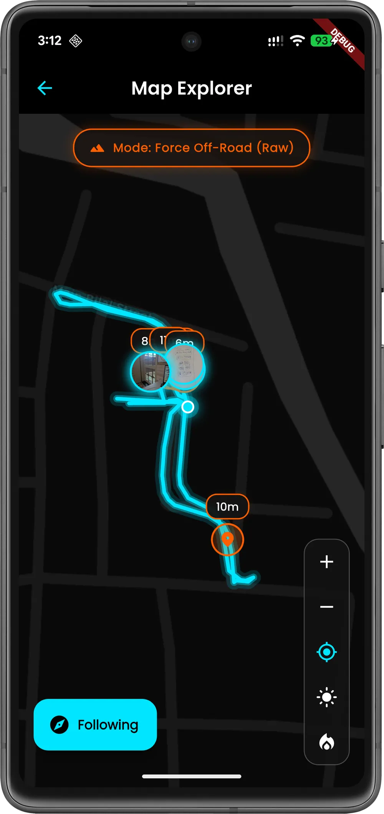
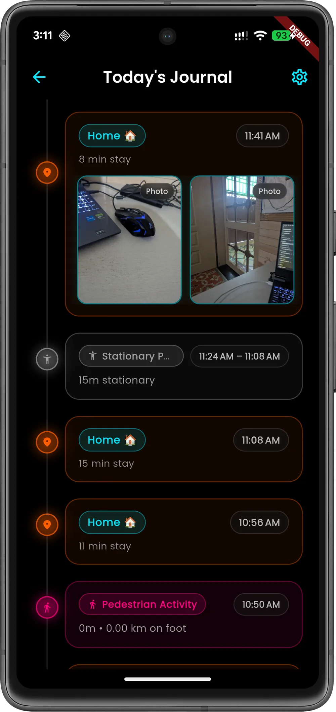
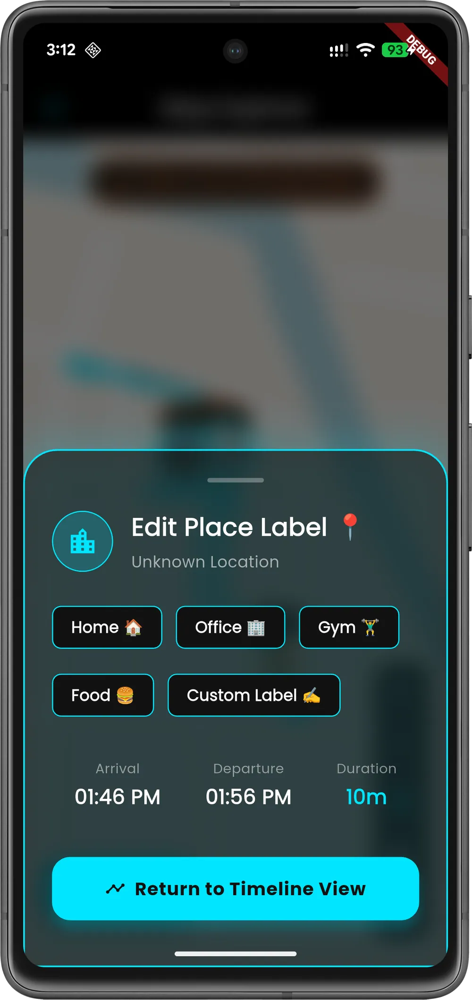
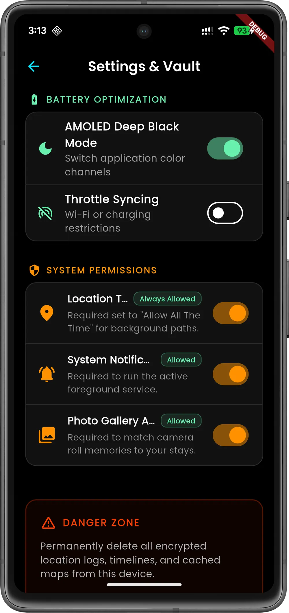

  

# GeoPrints

**An Android travel diary that automatically logs your stays, routes and photos, with all location history kept on your phone.**

> **Portfolio showcase.** The source code is private. This repository presents the project with screenshots and a technical overview. Full case study: **[farhadnazir.com/projects/geoprints](https://farhadnazir.com/projects/geoprints/)**

 

| | |
|---|---|
| **Type** | Private location journal for Android |
| **Categories** | Mobile app |
| **Platforms** | Mobile |
| **My role** | Solo developer and designer |
| **Status** | Live on Google Play |
| **Timeline** | 2026 |

## Overview

GeoPrints (listed on Google Play as Smart Travel Diary - GeoPrints) is an Android app that builds a daily timeline of where you went, how long you stayed and how you got there, without any check-ins. A background service records location, detects stays and movements, and attaches photos from your gallery that were taken at the same time.

The app has no backend, no user accounts and no analytics SDK. Location history is stored in a local database on the phone and is not uploaded anywhere; it only leaves the device as a file when the user exports it. Map tiles and address lookups do use the network. On top of that data sit a journal timeline, a map explorer with a heatmap, a history calendar, search, place labels and a weekly life-balance summary.

I designed and built the Flutter app, the landing website and the Play Store listing graphics. The app is published on Google Play under my company, Techwine Solutions.

**Who it is for:** Android users who want an automatic personal travel and location journal without sending their location history to a cloud service.

## The problem

Remembering where you went and which photos belong to which place usually means manual check-ins, or a cloud timeline service that uploads your full location history to someone else's servers.

Raw phone GPS is also unreliable. Mock locations, inaccurate fixes and sudden jumps produce distance that was never travelled, routes that cut through buildings and stays that never happened. A diary built on that data is not worth keeping.

## The solution

I built a foreground location service that adapts its sampling to how the user is moving, rejects bad fixes before they are stored, and detects stays using an error-aware radius. Everything is written to a local Isar database that the app's screens read from directly.

The interface turns that data into a readable day: a journal of stays and movements, a map with cleaned routes and photo markers, and summaries of where time was spent. Gallery photos are matched to timeline events by timestamp, and users can export everything as JSON and GPX, auto-delete data older than 30 days or wipe it all.

## Key features

- **Automatic background tracking.** An Android foreground service samples location with separate profiles for walking, cycling, driving and staying still. Writes are buffered, and an open stay resumes correctly after a restart.
- **GPS noise filtering.** Mock locations, inaccurate fixes and physically impossible speeds are dropped. A sudden far jump is held until the next fix confirms whether it was real movement or a spike.
- **Stay detection.** A stay begins when recent fixes over several minutes fit within an accuracy-aware radius, and ends only after consecutive fixes fall outside the exit radius, so brief GPS drift does not split a visit.
- **Today's Journal.** A chronological timeline of stays and movements for the day, with durations, distance for each movement and a total count of stays.
- **Gallery photo matching.** Photos taken today are attached to the timeline event closest in time. The app reads only timestamps and file paths, and the photos never leave the device.
- **Map Explorer with heatmap.** Cleaned routes split by activity, clustered stay and photo markers, follow mode, dark and light basemaps and a heatmap of frequently visited areas. Viewed map tiles are cached on the device.
- **Place labels.** Frequently visited places can be labelled Home, Office, Gym, Food or a custom name, and those labels then replace raw addresses across the timeline.
- **History calendar and search.** A month calendar marks recorded days and opens each day's activity. Search covers past locations with quick filters such as stays longer than 15 minutes, food and coffee.
- **Life balance and daily story.** A rolling 7-day split of time at home, at the office, in transit and elsewhere, plus a rule-based written summary of each day generated on the device.
- **Data ownership controls.** Export the full history as JSON and GPX through the share sheet, auto-delete records older than 30 days, clear the map cache or delete all data.

## Screenshots

<table>
<tr>
<td width="33%" valign="top" align="center"> Map Explorer draws the recorded route with stay markers and matched photos.</td>
<td width="33%" valign="top" align="center"> Gallery photos are attached to the timeline event closest in time.</td>
<td width="33%" valign="top" align="center"> Frequent places can be given a label that replaces the raw address.</td>
</tr>
<tr>
<td width="33%" valign="top" align="center"> Each permission is explained in the app, with its current status.</td>
</tr>
</table>

## Architecture

GeoPrints is an offline-first Flutter app organised by feature, with Riverpod providers over a local Isar database. There is no server: background work runs in an Android foreground service isolate, and the UI and the service share the same database schema.

The tracking logic (point filtering and stay detection) is plain Dart with no Flutter dependencies, which let me cover it with unit tests. Maps use flutter_map with CARTO and OpenStreetMap tiles, addresses come from the phone's built-in geocoder with a local cache, and a nightly local notification reminds the user to review the day.

The landing page is a single static site built with HTML, Tailwind CSS and vanilla JavaScript, with structured data for the app, the organization and the FAQ.

- **Privacy by architecture.** I chose to have no backend, no accounts and no analytics at all. Location data stays in the on-device database unless the user starts an export, so privacy does not depend on a policy page alone.
- **Tested tracking core.** The tracking and route-cleaning code is covered by 20 unit tests, including cases for mock fixes, accuracy limits, speed limits, spikes and stay entry and exit.
- **Battery-aware sampling.** Sampling intervals change with the motion mode reported by Android activity recognition, with a short fast-sampling window to catch the moment a user leaves a stay.
- **On-device route cleaning.** An earlier build snapped routes using a public OSRM server. I replaced it with on-device smoothing that breaks lines at time and distance gaps, splits them by activity and removes redundant points, so recorded routes are no longer sent to an outside server.
- **Shared database across isolates.** One Isar schema list is used by both the UI and the background service isolate, with stays, location points, place labels and a geocode cache keyed at roughly 50 meters to avoid repeated lookups.
- **Play policy compliance.** A prominent location disclosure and a permissions hub explain each permission before it is requested. No native permission prompt fires on launch, and restart on boot only happens when background location is granted.
- **Large exports.** JSON and GPX 1.1 exports are written in pages of 5,000 records, so long histories can be exported without loading everything into memory at once.

## Tech stack

`Flutter` · `Dart` · `Android` · `Riverpod` · `Isar` · `flutter_map` · `OpenStreetMap` · `Android Activity Recognition` · `GitHub Actions` · `Tailwind CSS` · `JavaScript`

## Links

- Case study: https://farhadnazir.com/projects/geoprints/
- Get it on Google Play: https://play.google.com/store/apps/details?id=com.techwinesolutions.geoprintsapp
- Visit live website: https://www.techwinesolutions.com/geoprintsapp

## About the developer

Built by **Farhad Nazir**, full-stack software developer in Riyadh, Saudi Arabia, and founder of [Techwine Solutions](https://www.techwinesolutions.com). I build SaaS platforms, business systems, and mobile and desktop apps.

[Portfolio](https://farhadnazir.com) · [LinkedIn](https://www.linkedin.com/in/farhadnazir) · [Email](mailto:farhadnazirksa@gmail.com) · [WhatsApp](https://wa.me/966536566380)

---

Screenshots are shown for portfolio purposes. Rights to each product and its branding belong to their owners. Screens marked "recreated" use demo data, so no real customer data appears.
